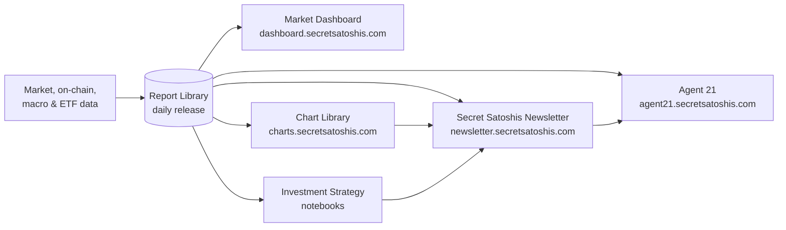

# Secret Satoshis

**Bitcoin market analysis, open data, and AI tools for long-term investors — founded by [Trey Brunson](https://treybrunson.com/).**

Built on a decade of Bitcoin industry experience across advisory, crypto exchanges, institutional Bitcoin financial products, and crypto venture funds at **Blockchain.com**, **Grant Thornton**, **Binance.US**, **21Shares**, and **Tribe Capital**. These repositories hold the open data pipelines, interactive charts, and research notebooks behind Secret Satoshis so anyone can inspect, verify, rerun, or build on the work.

- **Start here:** [secretsatoshis.com](https://secretsatoshis.com/)
- **Newsletter:** [newsletter.secretsatoshis.com](https://newsletter.secretsatoshis.com/)
- **Market Dashboard:** [dashboard.secretsatoshis.com](https://dashboard.secretsatoshis.com/)
- **Chart Library:** [charts.secretsatoshis.com](https://charts.secretsatoshis.com/)
- **Agent 21:** [agent21.secretsatoshis.com](https://agent21.secretsatoshis.com/)

## Where the work is published

| Site | What's there |
|------|--------------|
| **[Secret Satoshis](https://secretsatoshis.com/)** | Introduction to the yearly Bitcoin price outlook, Agent 21, and open research tools |
| **[Newsletter](https://newsletter.secretsatoshis.com/)** | Weekly Bitcoin Recaps, quarterly price outlook reviews, yearly price outlooks, and year-end reviews |
| **[Market Dashboard](https://dashboard.secretsatoshis.com/)** | Daily Bitcoin market data, valuation models, on-chain conditions, ETF flows, and cycle context |
| **[Chart Library](https://charts.secretsatoshis.com/)** | 54 interactive charts covering price, ETF flows, on-chain activity, supply, mining, and valuation |
| **[Agent 21](https://agent21.secretsatoshis.com/)** | The Bitcoin-native AI analyst built by Secret Satoshis (invite-only beta) |

## How it fits together

The Report Library collects the data, validates it, and publishes a daily release with a
manifest recording the report date and each file's SHA-256 hash. The Market Dashboard,
Chart Library, Investment Strategy notebooks, Newsletter, and Agent 21 all consume that
verified release, and anyone can check the published files against the
[release manifest](https://secretsatoshis.github.io/Bitcoin-Report-Library/csv/release_manifest.json).

## Public repositories

| Repository | What it does |
|------------|--------------|
| **[Bitcoin-Report-Library](https://github.com/SecretSatoshis/Bitcoin-Report-Library)** | Collects and validates market, macro, on-chain, and ETF data, publishes the daily release, and hosts the Market Dashboard |
| **[Bitcoin-Chart-Library](https://github.com/SecretSatoshis/Bitcoin-Chart-Library)** | Chart definitions and static site generator for the interactive Chart Library |
| **[Bitcoin-Investment-Strategy](https://github.com/SecretSatoshis/Bitcoin-Investment-Strategy)** | A savings plan tested against real price history — companion to [*Should I buy bitcoin?*](https://newsletter.secretsatoshis.com/p/should-i-buy-bitcoin) — plus studies of Bitcoin's supply and demand |
| **[Trey-Brunson-Website](https://github.com/SecretSatoshis/Trey-Brunson-Website)** | Founder [Trey Brunson](https://treybrunson.com/)'s personal site, `treybrunson.com` |
| **[.github](https://github.com/SecretSatoshis/.github)** | Organization profile, community health defaults, and shared CI composite actions |

## License & Disclaimer

Research, not investment advice. Code and original content are released under GPL-3.0;
each repository's `LICENSE` sets its scope, and third-party data keeps its publishers' terms.

---

**Don't trust. Verify.**
